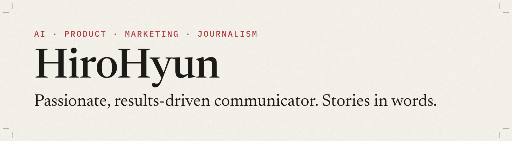
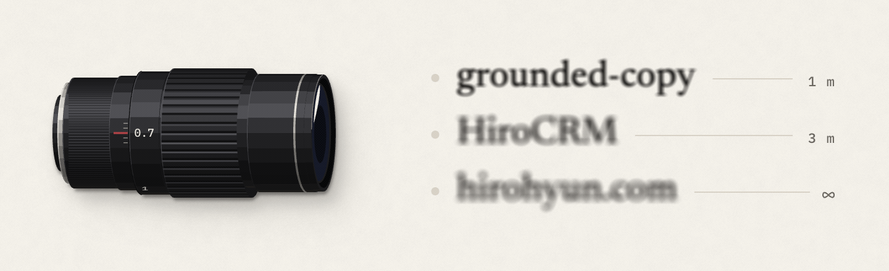
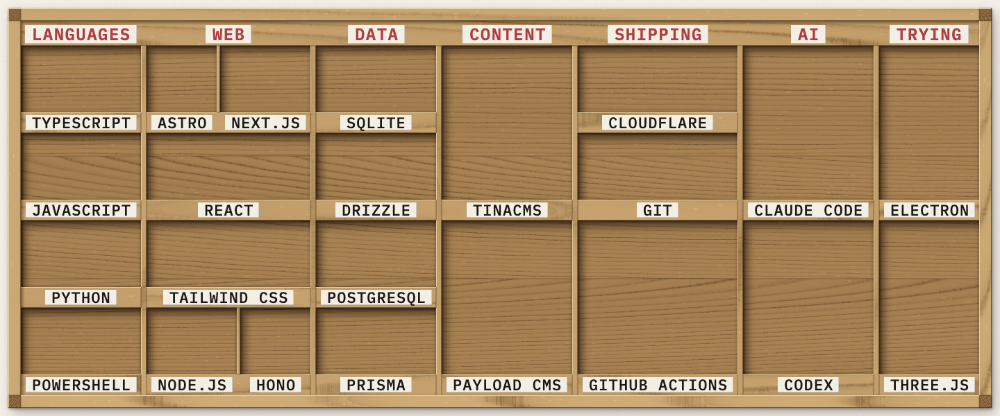
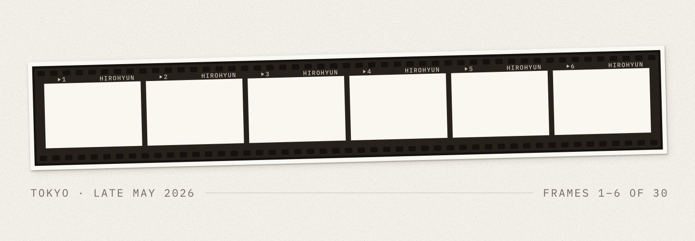

<picture>
  <source media="(prefers-reduced-motion: reduce) and (prefers-color-scheme: dark)" srcset="media/banner-dark.png">
  <source media="(prefers-reduced-motion: reduce)" srcset="media/banner-light.png">
  <source media="(prefers-color-scheme: dark)" srcset="media/banner-dark.gif">
  
</picture>

I'm HiroHyun. I work on market validation and community launch for AI-native products: I study the problems people describe in their communities and turn their own words into user stories and product copy. My background is in journalism and B2B marketing. I also take photographs and build tools with AI.

### Projects

<picture>
  <source media="(prefers-reduced-motion: reduce) and (prefers-color-scheme: dark)" srcset="media/projects-dark.png">
  <source media="(prefers-reduced-motion: reduce)" srcset="media/projects-light.png">
  <source media="(prefers-color-scheme: dark)" srcset="media/projects-dark.gif">
  
</picture>

**[grounded-copy](https://github.com/HiroHyun/grounded-copy)** · Rules and a checker that make an AI agent state the fact and get to the point, in its chat replies and in the documents it writes. A plugin for Claude Code and Codex. [Product page](https://hirohyun.github.io/groundedcopy/)

**[HiroCRM](https://github.com/HiroHyun/HiroCRM)** · A small CRM for international-trade teams that keeps the last conversation beside the next follow-up, in one SQLite file you host yourself.

**[hirohyun.com](https://hirohyun.com/)** · My site for writing and photographs, in English and Chinese, built with Astro and TinaCMS.

Lately I've also been exploring AI companions: how they remember, when they speak, and what it feels like to have one beside a game.

### What I build with

<picture>
  <source media="(prefers-reduced-motion: reduce) and (prefers-color-scheme: dark)" srcset="media/stack-dark.png">
  <source media="(prefers-reduced-motion: reduce)" srcset="media/stack-light.png">
  <source media="(prefers-color-scheme: dark)" srcset="media/stack-dark.gif">
  
</picture>

### From my camera

<picture>
  <source media="(prefers-reduced-motion: reduce) and (prefers-color-scheme: dark)" srcset="media/contact-dark.png">
  <source media="(prefers-reduced-motion: reduce)" srcset="media/contact-light.png">
  <source media="(prefers-color-scheme: dark)" srcset="media/contact-dark.gif">
  
</picture>

The rest of the roll is in [Tokyo, Late May](https://hirohyun.com/gallery/2026-tokyo-may/).

<picture>
  <source media="(prefers-reduced-motion: reduce) and (prefers-color-scheme: dark)" srcset="media/year-dark-still.svg">
  <source media="(prefers-reduced-motion: reduce)" srcset="media/year-light-still.svg">
  <source media="(prefers-color-scheme: dark)" srcset="media/year-dark.svg">
  
</picture>

<picture>
  <source media="(prefers-reduced-motion: reduce) and (prefers-color-scheme: dark)" srcset="media/end-dark.png">
  <source media="(prefers-reduced-motion: reduce)" srcset="media/end-light.png">
  <source media="(prefers-color-scheme: dark)" srcset="media/end-dark.gif">
  
</picture>

